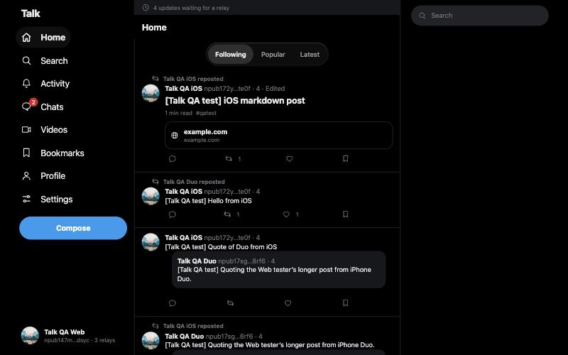
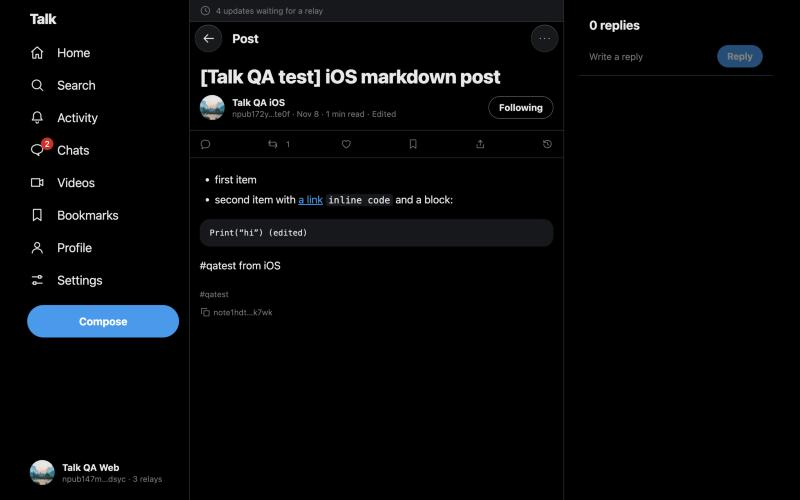
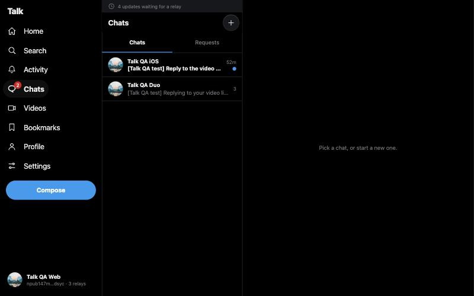
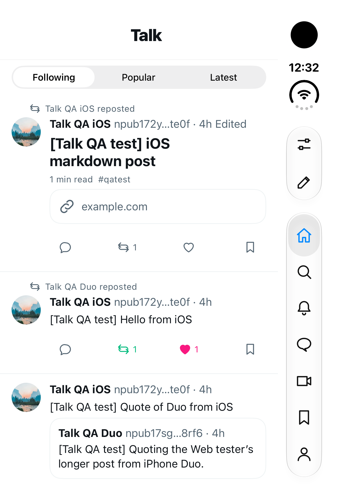

# Talk

**A small, positive network for builders, with no server behind it.**

Talk is a serverless take on [KarpathyTalk](https://karpathytalk.com): posts are markdown documents with a
Twitter-like social layer (likes, reposts, quotes, replies, follows). Talk keeps the idea but stores everything on
**Nostr** relays, so there is no backend to pay for, your account is a key you own, and it works the same in every app.

**[Open Talk on the web](https://yet300.github.io/Talk/)** · **[Download the Android APK](https://github.com/yet300/Talk/releases/latest)**

| Feed | Article | Chats |
|---|---|---|
|  |  |  |

<p align="center"></p>

Native apps for **Android** (Compose), **iOS** (SwiftUI, with iPhone Duo layouts) and the **web** (Compose HTML), sharing
all logic through Kotlin Multiplatform.

## Features

- Sign in with a Nostr key: create one or import your `nsec`. It stays on your device
- Markdown posts (GFM, code blocks, images) up to 10,000 characters
- Replies, quote posts, reposts, likes, bookmarks, follows
- Editable posts with a full revision history
- Feeds: Following, Popular (Hacker News-style ranking), Latest; Activity and search
- Profiles with Posts, Replies and Bookmarks, NIP-05 and GitHub verification
- End-to-end encrypted chats and groups (NIP-17): reactions, replies, images, disappearing messages, safety codes
- Videos: the HackerTube catalog, likes, comments and Watch later
- Moderation: mute, block, hide and NIP-56 reports; an app lock on every platform

How each feature maps to Nostr events: [docs/nostr-protocol.md](docs/nostr-protocol.md).

## Project layout

```
app/androidApp    Android app (Compose)
app/iosApp        iOS app (SwiftUI)
app/webApp        Web app (Compose HTML)
shared/logic      Shared logic and DI graphs, exported to iOS (SharedLogic.framework)
shared/ui         Android Compose UI
core/*            Domain, data, Nostr, database, resources (strings, colours, icons, tokens)
feature/*         Decompose components and MVIKotlin stores per screen
build-logic       Gradle convention plugins
docs              Protocol and research notes
```

Architecture, conventions and commands are in [AGENTS.md](AGENTS.md).

## Getting started

You need **JDK 17**, the **Android SDK** (platform 37) for Android, and **Xcode 27.1 or later** for iOS.

```bash
git clone https://github.com/yet300/Talk.git
cd Talk
```

| Platform | How to run |
|---|---|
| Web | `./gradlew :webApp:jsBrowserDevelopmentRun --continuous`, then open http://localhost:8080 |
| Android | `./gradlew :androidApp:assembleDebug`, or the run configuration in Android Studio |
| iOS | Open `app/iosApp/iosApp.xcodeproj` in Xcode and run the `iosApp` scheme |

The first build downloads Kotlin/Native and takes a while.

## Contributing

Contributions are welcome. Before you start:

1. Read [AGENTS.md](AGENTS.md) for the architecture and conventions, and
   [docs/nostr-protocol.md](docs/nostr-protocol.md) before touching anything that creates or reads events: events
   already on relays can't be migrated.
2. Screens follow [docs/design/ui-review.md](docs/design/ui-review.md).
3. Work on a branch and open a pull request against `main`. CI runs the Android, web and iOS builds and tests.
4. Run the narrowest check that covers your change:

```bash
./gradlew testAndroidHostTest
```

```bash
./gradlew jsTest
```

```bash
./gradlew iosSimulatorArm64Test
```

Tests never publish to public relays, and you should not either: use a throwaway key when you try the app. Never log or
commit a private key.

## License

Talk is licensed under the [Apache License 2.0](LICENSE). The video catalog comes from
[HackerTube](https://hackertube.org) under ODC-By 1.0.
